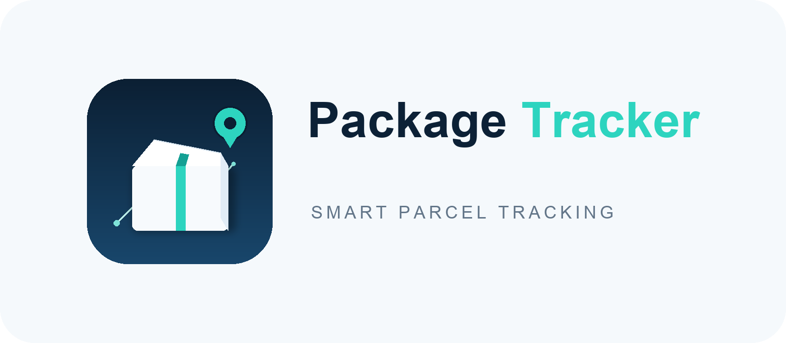

# Package Tracker

[English](README.md) · **Deutsch**



Intelligente Paketverwaltung für Home Assistant – vollständig lokal, ohne externe KI und ohne Marketing-Datenbank. Standardsprache ist Englisch; die deutsche Übersetzung ist enthalten.

Package Tracker verbindet dein Gmail-Postfach über die offizielle Gmail API (nur lesend), erkennt Bestell- und Versand-E-Mails, führt zusammengehörige Nachrichten zu **einem Paket** zusammen und stellt alles über eine native Home-Assistant-Integration, Sensoren, Events, Automationen und eine eigene Lovelace-Karte bereit.

> **Status:** 1.0.3 – produktiv nutzbar, getestet mit Home Assistant 2026.10.4, Python 3.14, TypeScript/Lit 3.
>
> **Wichtig:** Die Paketerkennung ist eine lokale Heuristik. Sie ist bewusst konservativ und wird ständig um echte Händler-/Paketdienst-Vorlagen erweitert. Es werden **keine** erfundenen Trackingdaten angezeigt. Fehlt eine offizielle Schnittstelle, bleibt das Feld leer.

---

## Inhaltsverzeichnis

1. [Funktionsumfang](#funktionsumfang)
2. [Architektur und Datenmodell](#architektur-und-datenmodell)
3. [Voraussetzungen](#voraussetzungen)
4. [Installation über HACS](#installation-über-hacs)
5. [Manuelle Installation](#manuelle-installation)
6. [Google Cloud und Gmail API einrichten](#google-cloud-und-gmail-api-einrichten)
7. [Integration einrichten](#integration-einrichten)
8. [Optionen](#optionen)
9. [Dashboard-Karte](#dashboard-karte)
10. [Sensoren und Entities](#sensoren-und-entities)
11. [Events](#events)
12. [Services / Actions](#services--actions)
13. [Benachrichtigungen](#benachrichtigungen)
14. [Automationen und Smart-Home-Integration](#automationen-und-smart-home-integration)
15. [Optional: externes Tracking](#optional-externes-tracking)
16. [Datenschutz und Sicherheit](#datenschutz-und-sicherheit)
17. [Fehlerbehebung](#fehlerbehebung)
18. [Grenzen und bewusste Entscheidungen](#grenzen-und-bewusste-entscheidungen)
19. [Entwicklung und Tests](#entwicklung-und-tests)
20. [Release und HACS-Veröffentlichung](#release-und-hacs-veröffentlichung)

---

## Funktionsumfang

- **Gmail API, ausschließlich lesend** (`gmail.readonly`), OAuth2 über den Home-Assistant-Config-Flow.
- **Lokale E-Mail-Analyse** in Python: Absender, Betreff, Text, HTML, Links, Produktbilder, Bestellnummern, Sendungsnummern, Liefertermine und Zeitfenster.
- **Zentrale Paketverwaltung** mit Bestellungen und Sendungen. Eine Bestellung kann mehrere Sendungen enthalten; mehrere E-Mails werden zu einem Paket zusammengeführt.
- **Unterstützte Paketdienste:** DHL, Deutsche Post, Hermes, DPD, GLS, UPS, FedEx, Amazon Logistics.
- **10 Statuswerte:** `ordered`, `shipped`, `in_transit`, `out_for_delivery`, `delivered`, `delayed`, `ready_for_pickup`, `returned`, `cancelled`, `unknown`.
- **Persistente Speicherung** über Home Assistant `Store`, übersteht Neustarts und Updates.
- **Events** für jede Statusänderung und ein eigenes Event-System für Automationen.
- **Optionale Push-Benachrichtigungen** über die normale Home-Assistant-`notify`-Architektur – anbieterunabhängig und ohne Duplikate.
- **Native Device-Trigger, Conditions und Actions** für den Automation-Editor.
- **Eigene Lovelace-Karte** `custom:package-tracker-card` mit Übersicht, Filtern, Suche, Sortierung, Detailansicht und visuellem Konfigurationseditor.
- **Optionales externes Tracking** (DHL Unified API oder eigener JSON-Endpunkt) – standardmäßig aus, Fehler isoliert.
- **Datenschutz:** Keine E-Mail-Inhalte werden dauerhaft gespeichert, keine Weitergabe an KI-Dienste, Tokens werden in Diagnostics geschwärzt.

### Bewusst nicht enthalten

- Keine erfundenen Tracking-Events, keine Demo-Pakete in der produktiven Ansicht.
- Kein Scraping von Paketdienst-Websites als Voraussetzung.
- Keine verpflichtende kostenpflichtige Tracking-API.
- Keine externe KI-API.
- Keine Garantie auf minutengenaue Lieferfenster – diese stammen aus den E-Mails des Händlers/Paketdienstes.

---

## Architektur und Datenmodell

```text
Gmail API (readonly)
        │
        ▼
GmailClient ──► EmailParser (lokal, regelbasiert)
        │                 │
        │                 ▼
        │           ParsedEmail
        │                 │
        ▼                 ▼
PackageTrackerCoordinator ◄── PackageManager (eine gemeinsame Datenquelle)
        │                         │
        │                         ├── Order (Bestellung)
        │                         └── Shipment (Sendung = Paket)
        │
        ├── Home-Assistant-Events
        ├── Notify-Services
        ├── Sensoren / Binary Sensoren / Buttons
        ├── Services & Device-Automationen
        ├── WebSocket-API
        └── Lovelace-Karte
```

### Bestellung vs. Sendung

- **Order**: Händler, Bestellnummer, Bestelldatum, Produktliste, zugehörige Sendungen und E-Mail-Referenzen.
- **Shipment**: das physische Paket mit eigener stabiler ID, Paketdienst, Sendungsnummer, Produkt, Terminen und kompletter Statushistorie.

Eine Bestellung kann mehrere Sendungen enthalten (z. B. Amazon teilt eine Bestellung in zwei Pakete). Mehrere E-Mails zu derselben Sendung werden zusammengeführt.

### Stabile IDs

- Sendungs-ID: aus normalisierter Sendungsnummer (falls vorhanden), sonst deterministisch aus Bestellung/Thread/E-Mail.
- Bestell-ID: aus Händler + Bestellnummer, sonst aus Thread/E-Mail.
- Die IDs bleiben über Neustarts erhalten und werden in der Store-Datei gespeichert.

### Zusammenführungsregeln (Auszug)

1. Gleiche normalisierte Sendungsnummer → gleiche Sendung.
2. Gleiche Bestellnummer + Händler → passende Sendung; vorhandene Platzhalter-Sendung wird angereichert.
3. Neue Sendungsnummer zu einer bestehenden Bestellung → neue Sendung (Mehrpaket-Bestellung).
4. Keine Sendungsnummer: Produktähnlichkeit, Bestellnummer, Händler und Zeitfenster; nur bei eindeutigem Treffer wird zusammengeführt.
5. Retourenlabel ≠ retourniertes Paket. Ein Retourenlabel ändert den Status nicht.
6. Status wird nie automatisch zurückgestuft; `delivered`, `returned`, `cancelled` sind terminal.
7. Bereits verarbeitete Gmail-Message-IDs werden persistent gespeichert. Überlappende Sync-Fenster erzeugen keine Duplikate.

---

## Voraussetzungen

- Home Assistant **2026.10 oder neuer** (getestet mit 2026.10.4).
- Ein Google-Konto mit Gmail.
- Ein Google-Cloud-Projekt mit aktivierter **Gmail API**.
- Für die OAuth-Weiterleitung eine öffentlich erreichbare **HTTPS-URL**:
  - empfohlen: **My Home Assistant** (`https://my.home-assistant.io/redirect/oauth`), oder
  - eine konfigurierte externe HTTPS-URL, z. B. `https://home.example.de/auth/external/callback`.
- Internetzugriff von Home Assistant auf `gmail.googleapis.com`, `oauth2.googleapis.com` und `accounts.google.com`.

---

## Installation über HACS

1. HACS öffnen → **Integrationen** → Drei-Punkte-Menü → **Benutzerdefinierte Repositories**.
2. Repository-URL dieses Projekts eintragen, Kategorie **Integration**.
3. **Package Tracker** installieren.
4. Home Assistant neu starten.
5. **Einstellungen → Geräte & Dienste → Integration hinzufügen → Package Tracker**.
6. Gmail verbinden (siehe unten).

Die Lovelace-Karte ist im Integrationspaket enthalten. Sie wird beim Laden der Integration automatisch als Frontend-Ressource registriert (`/package_tracker_static/package-tracker-card.js`). Ein manuelles Bearbeiten von Home-Assistant-Core-Dateien ist nicht nötig.

Falls die Karte nach einem Update nicht erscheint: Browser-Cache leeren bzw. die Ressource einmal neu laden. Als Fallback kann sie manuell unter **Einstellungen → Dashboards → Ressourcen** als JavaScript-Modul eingetragen werden:

```text
/package_tracker_static/package-tracker-card.js
```

---

## Manuelle Installation

1. Ordner `custom_components/package_tracker` aus diesem Repository nach
   `<HA-Konfigurationsordner>/custom_components/package_tracker` kopieren.
2. Sicherstellen, dass `manifest.json`, alle Python-Dateien und
   `frontend/package-tracker-card.js` vorhanden sind.
3. Home Assistant neu starten.
4. Integration über die UI hinzufügen.

---

## Google Cloud und Gmail API einrichten

Diese Schritte erfolgen einmalig in der [Google Cloud Console](https://console.cloud.google.com/).

### 1. Projekt anlegen

Neues Projekt erstellen, z. B. `Home Assistant Package Tracker`.

### 2. Gmail API aktivieren

**APIs & Dienste → Bibliothek → Gmail API → Aktivieren**.

### 3. OAuth-Zustimmungsbildschirm

**APIs & Dienste → OAuth-Zustimmungsbildschirm**:

- Nutzertyp: **Extern** (für private Google-Konten).
- App-Name, Support-E-Mail und Entwicklerkontakt ausfüllen.
- **Scopes:** `https://www.googleapis.com/auth/gmail.readonly` hinzufügen.
- Im Testmodus das eigene Google-Konto als **Testnutzer** hinzufügen.
- Für dauerhaften Betrieb die App veröffentlichen; Google kann bei sensiblen Scopes eine Verifizierung verlangen. Das ist ein Google-Prozess, kein Bestandteil dieser Integration.

### 4. OAuth-Client erstellen

**APIs & Dienste → Anmeldedaten → Anmeldedaten erstellen → OAuth-Client-ID**:

- Anwendungstyp: **Webanwendung**.
- Name: z. B. `Home Assistant`.
- **Autorisierte Weiterleitungs-URI:**

```text
https://my.home-assistant.io/redirect/oauth
```

oder, falls du kein My Home Assistant verwendest:

```text
https://<deine-externe-home-assistant-url>/auth/external/callback
```

Die URI muss **exakt** mit der URI übereinstimmen, die im Config-Flow angezeigt wird (inkl. `https://`, ohne trailing slash).

### 5. Client-ID und Client-Secret notieren

Beides wird gleich in Home Assistant eingetragen. Das Client-Secret ist kein Gmail-Passwort; es identifiziert nur die OAuth-Anwendung.

> **Sicherheit:** Das Client-Secret wird im Home-Assistant-Config-Entry gespeichert (wie bei anderen OAuth-Integrationen). Tokens werden von Home Assistant verwaltet und bei Bedarf automatisch erneuert. In Diagnostics werden Secrets geschwärzt.

---

## Integration einrichten

1. **Einstellungen → Geräte & Dienste → Integration hinzufügen → Package Tracker**.
2. Client-ID und Client-Secret einfügen.
3. Auf **Weiter** klicken; Google-Anmeldung im Popup durchführen.
4. Der **lesende Gmail-Zugriff** muss erlaubt werden. Ohne diesen Scope bricht die Einrichtung mit einer verständlichen Meldung ab.
5. Sync-Intervall und ersten Importzeitraum wählen.
6. Optional direkt einen `notify`-Dienst und Benachrichtigungsereignisse konfigurieren.
7. Fertigstellen. Der erste Import startet sofort.

### Synchronisierung

- Standardintervall: **5 Minuten** (einstellbar 1–1440).
- Erster Import: standardmäßig **30 Tage** (einstellbar 1–365).
- Gmail-Suchanfrage ist konfigurierbar; Standard ist bewusst breit und wird lokal präzisiert.
- Gelesene und archivierte E-Mails werden berücksichtigt. Es wird nicht `is:unread` verwendet.
- Manuelle Synchronisierung: Button `button.package_tracker_sync` oder Service `package_tracker.sync`.
- Obergrenze pro Sync: standardmäßig 1000 Nachrichten. Bei Überschreitung wird geloggt; Obergrenze bzw. Suchanfrage anpassen.
- Token-Erneuerung erfolgt automatisch über Home Assistant. Bei entzogenem Zugriff startet die Integration einen Reauth-Flow und erstellt ein Repair-Issue.

---

## Optionen

**Einstellungen → Geräte & Dienste → Package Tracker → Konfigurieren**

| Option | Standard | Bedeutung |
|---|---:|---|
| Synchronisierungsintervall | 5 min | Gmail-Abruf; 1–1440 Minuten |
| Erster Import | 30 Tage | Zeitfenster des initialen Abrufs |
| Gmail-Suchanfrage | breite Standardabfrage | serverseitiger Gmail-Filter; lokale Analyse bleibt maßgeblich |
| Max. Nachrichten pro Sync | 1000 | Schutz vor Überlastung |
| E-Mail-Betreffzeilen speichern | an | nur Betreff-Metadaten; Inhalte werden nie gespeichert |
| Aufbewahrung zugestellter Pakete | 90 Tage | automatische Bereinigung; `0` = dauerhaft |
| Bestell-Platzhalter | 7 Tage | nur Bestellbestätigungen der letzten X Tage als aktives Paket anzeigen; `0` = unbegrenzt. Ältere Bestellungen werden gespeichert, erscheinen aber erst, wenn eine Versand-/Tracking-Mail eintrifft. |
| Benachrichtigungsdienst | leer | z. B. `mobile_app_handy` oder `notify.mobile_app_handy` |
| Benachrichtigungsereignisse | u. a. Zustellung, Verspätung | Mehrfachauswahl |
| Tracking-Anbieter | deaktiviert | `dhl_unified` oder `custom_json` |
| Tracking-Intervall | 60 min | `0` = aus |
| Tracking-API-Key | leer | für DHL Unified API |
| Tracking-URL / Header / JSON-Pfade | leer/Defaults | für eigenen JSON-Endpunkt |

Änderungen werden ohne Neustart übernommen. Ein neues Sync-Intervall greift sofort.

---

## Dashboard-Karte

### Karte hinzufügen

Dashboard bearbeiten → **Karte hinzufügen** → manuell:

```yaml
type: custom:package-tracker-card
```

Oder den visuellen Editor verwenden. Die Karte wird automatisch als Ressource geladen.

### Vollständige YAML-Konfiguration

```yaml
type: custom:package-tracker-card
title: Pakete
max_packages: 12
show_delivered: false
show_images: true
show_delivery_dates: true
compact: false
default_filter: all
sort_by: expected
show_stats: true
show_search: true
show_last_sync: true
```

| Option | Typ | Standard | Beschreibung |
|---|---|---|---|
| `title` | string | `Pakete` | Überschrift |
| `max_packages` | number | 24 | maximal angezeigte Pakete |
| `show_delivered` | boolean | false | zugestellte Pakete standardmäßig anzeigen |
| `show_images` | boolean | true | Produktbilder aus E-Mails anzeigen, sofern vorhanden |
| `show_delivery_dates` | boolean | true | Lieferdatum/Zeitfenster auf Karten |
| `compact` | boolean | false | kompakte Listenansicht |
| `default_filter` | string | `all` | `all`, `transit`, `today`, `delivered`, `delayed`, `pickup` |
| `sort_by` | string | `expected` | `expected`, `carrier`, `merchant`, `status` |
| `show_stats` | boolean | true | Statistikleiste anzeigen |
| `show_search` | boolean | true | Suchfeld anzeigen |
| `show_last_sync` | boolean | true | letzten Gmail-Sync im Kopf anzeigen |

### Bedienung

- **Statistik-Kacheln**: Unterwegs, Heute, Zugestellt, Nächste Lieferung. Klick setzt den Filter.
- **Filter-Chips**: Alle, Unterwegs, Heute, Zugestellt, Verspätet, Abholbereit.
- **Suche**: Händler, Produkt, Sendungsnummer, Bestellnummer, Paketdienst.
- **Sortierung**: Lieferdatum, Paketdienst, Händler, Status.
- **Paket anklicken**: Detailansicht mit Bestellinformationen, Produkt, Sendungsnummer, Tracking-Link, kompletter Statushistorie, E-Mail-Metadaten, weiteren Sendungen der Bestellung und optionalem Tracking.
- **Tastatur**: Karten sind per Tab/Enter/Space bedienbar; Escape schließt die Detailansicht.
- **Responsive**: Smartphone (eine Spalte, Detail als Bottom-Sheet), Tablet und Desktop (Kachelraster).
- **Light/Dark**: ausschließlich Home-Assistant-CSS-Variablen, keine festen Hintergründe.
- **Keine Beispieldaten**: Im leeren Zustand erscheint ein Sync-Hinweis; im Fehlerfall eine Retry-Aktion.

### Datenquelle der Karte

Die Karte lädt zuerst über die WebSocket-API `package_tracker/packages` (vollständiger gemeinsamer Datenbestand inkl. Historie). Ist das nicht verfügbar, fällt sie auf die Attribute von `sensor.package_tracker_packages` und die per-Paket-Sensoren zurück. Updates kommen über das Event `package_tracker_updated`.

### Eigene Dashboard-Beispiele

```yaml
# Kompakt, nur aktive Pakete
type: custom:package-tracker-card
title: Unterwegs
compact: true
default_filter: transit
max_packages: 6
show_stats: false

# Tagesübersicht inkl. zugestellter Pakete
type: custom:package-tracker-card
default_filter: today
show_delivered: true
show_images: true
```

---

## Sensoren und Entities

Alle Aggregat-Entities hängen am Gerät **Package Tracker**.

| Entity | State | Wichtige Attribute |
|---|---|---|
| `sensor.package_tracker_packages` | Anzahl aktiver Pakete | `packages`, `counts`, `gmail`, `sync`, `updated_at` |
| `sensor.package_tracker_deliveries_today` | Lieferungen heute | `packages`, `count` |
| `sensor.package_tracker_next_delivery` | nächstes Lieferdatum (`date`) | `package`, `product_name`, `merchant`, `carrier`, `delivery_window`, `tracking_url` |
| `sensor.package_tracker_delivered_today` | heute zugestellt | `packages`, `count` |
| `sensor.package_tracker_packages_in_transit` | Pakete unterwegs | `packages`, `count` |
| `sensor.package_tracker_delayed` | verspätete Pakete | `packages`, `count` |
| `sensor.package_tracker_last_sync` | Zeitpunkt des letzten Syncs | `emails_processed`, `connected`, `account` (standardmäßig deaktiviert) |

Zusätzlich:

| Entity | Bedeutung |
|---|---|
| `binary_sensor.package_tracker_delivery_today` | Lieferung für heute erwartet |
| `binary_sensor.package_tracker_package_out_for_delivery` | mindestens ein Paket in Zustellung |
| `binary_sensor.package_tracker_delayed` | mindestens ein Paket verspätet |
| `binary_sensor.package_tracker_gmail_connected` | Gmail-Konto verbunden (diagnostisch) |
| `button.package_tracker_sync` | manuelle Gmail-Synchronisierung |
| `button.package_tracker_refresh_tracking` | optionales Tracking aktualisieren |
| `sensor.package_tracker_package_<händler>_<id>` | ein Sensor pro erkanntem Paket |

Der per-Paket-Sensor hat den Status als State und u. a. diese Attribute:
`package_id`, `merchant`, `carrier`, `carrier_name`, `product_name`, `product_names`, `product_image`, `order_number`, `tracking_number`, `tracking_url`, `order_date`, `shipped_date`, `expected_delivery`, `delivery_window`, `actual_delivery`, `status_label`, `status_history`, `emails`, `order`, `siblings`, `tracking`, `completed`, `notes`.

Beispiel für Templates:

```jinja
{{ states('sensor.package_tracker_packages') }} Pakete aktiv
{{ state_attr('sensor.package_tracker_next_delivery', 'product_name') }}
{{ state_attr('sensor.package_tracker_next_delivery', 'delivery_window') }}
```

---

## Events

Jedes Ereignis enthält die relevanten Paketdaten, u. a. `package_id`, `merchant`, `carrier`, `carrier_name`, `product_name`, `product_names`, `order_number`, `tracking_number`, `tracking_url`, `status`, `previous_status`, `expected_delivery`, `delivery_window`, `actual_delivery`, `email_ids`, `entity_id`, `source` und `timestamp`.

| Event | Auslöser |
|---|---|
| `package_tracker_package_found` | neues Paket angelegt |
| `package_tracker_package_ordered` | Status `ordered` |
| `package_tracker_package_shipped` | Status `shipped` |
| `package_tracker_package_in_transit` | Status `in_transit` |
| `package_tracker_package_out_for_delivery` | Status `out_for_delivery` |
| `package_tracker_package_delivered` | Status `delivered` |
| `package_tracker_package_delayed` | Status `delayed` |
| `package_tracker_package_ready_for_pickup` | Status `ready_for_pickup` |
| `package_tracker_package_returned` | Status `returned` |
| `package_tracker_package_cancelled` | Status `cancelled` |
| `package_tracker_updated` | Datenbestand geändert (für Dashboards) |

Events werden nur bei echten Statusänderungen bzw. beim Anlegen ausgelöst. Wiederholte identische E-Mails oder identische Statusmeldungen erzeugen keine Duplikate.

---

## Services / Actions

Alle Services sind auch im Automation-Editor unter **Package Tracker** verfügbar. `config_entry_id` ist optional und nur bei mehreren Gmail-Konten nötig.

### `package_tracker.sync`

```yaml
action: package_tracker.sync
```

### `package_tracker.refresh`

Baut die Paketübersicht aus den gespeicherten Daten neu auf und benachrichtigt das Dashboard über `package_tracker_updated`, ohne Gmail abzurufen.

```yaml
action: package_tracker.refresh
```

### `package_tracker.refresh_tracking`

```yaml
action: package_tracker.refresh_tracking
data:
  package_id: "pkg_..."
```

### `package_tracker.mark_delivered`

```yaml
action: package_tracker.mark_delivered
data:
  package_id: "pkg_..."
  delivered_at: "2026-11-26"
```

### `package_tracker.mark_completed`

```yaml
action: package_tracker.mark_completed
data:
  package_id: "pkg_..."
  completed: true
```

### `package_tracker.update_package`

```yaml
action: package_tracker.update_package
data:
  package_id: "pkg_..."
  merchant: "Amazon"
  carrier: "DHL"
  tracking_number: "00340434161094000000"
  expected_delivery: "2026-11-27"
  delivery_window: "14:00–18:00 Uhr"
  status: delayed
```

### `package_tracker.delete_package`

```yaml
action: package_tracker.delete_package
data:
  package_id: "pkg_..."
```

### `package_tracker.delete_all_data`

```yaml
action: package_tracker.delete_all_data
data:
  confirm: true
  reset_sync: false
```

`reset_sync: true` setzt zusätzlich den Gmail-Wasserstand zurück; ältere E-Mails werden beim nächsten Sync erneut importiert.

### `package_tracker.disconnect_account`

Entfernt den Config-Entry, widerruft das Google-Token (best effort) und löscht die lokale Store-Datei.

```yaml
action: package_tracker.disconnect_account
```

### `package_tracker.get_packages`

Liefert eine Antwort (Response) für Skripte/Templates:

```yaml
action: package_tracker.get_packages
data:
  status: in_transit
response_variable: pakete
```

---

## Benachrichtigungen

Die Integration nutzt ausschließlich die normale Home-Assistant-`notify`-Architektur. Es gibt keine Bindung an einen bestimmten Push-Anbieter.

### Einrichtung

1. Einen funktionierenden Notify-Dienst einrichten (z. B. Home-Assistant-Companion-App).
2. In den Integration-Optionen den Dienstnamen ohne `notify.` eintragen, z. B. `mobile_app_handy`.
3. Ereignisse auswählen, z. B. „Paket in Zustellung“, „Paket zugestellt“, „Paket verspätet“, „Paket abholbereit“.

### Duplikatvermeidung

- Eine Benachrichtigung wird nur bei einer echten Statusänderung ausgelöst.
- Bereits verarbeitete Gmail-IDs werden persistent gespeichert.
- Zusätzlich wird pro Paket + Status ein Sendezeitpunkt gespeichert; identische Meldungen innerhalb von 12 Stunden werden unterdrückt.
- Fehlt der konfigurierte Notify-Dienst, wird gewarnt und nichts gesendet.

### Beispielnachricht

> **Paket ist in Zustellung**  
> Dein Paket ist unterwegs!
>
> „Logitech MX Master 4“ von Amazon wird heute voraussichtlich zwischen 14:00–18:00 Uhr zugestellt.
>
> Paketdienst: DHL  
> Sendungsnummer: 00340434161094000000

Bei Companion-Apps werden zusätzlich `tag`, `group`, `url` und `clickAction` mit dem Tracking-Link gesetzt.

### Alternative: eigene Automationen

Wer volle Kontrolle über Texte und Empfänger möchte, lässt den Notify-Dienst in den Optionen leer und reagiert auf die Events. Beispiele stehen in [docs/automations.md](docs/automations.md).

---

## Automationen und Smart-Home-Integration

Die Integration stellt native **Device-Trigger**, **Device-Conditions** und **Device-Actions** am Gerät „Package Tracker“ bereit.

### Trigger

- Paket erkannt
- Paket bestellt
- Paket versendet
- Paket unterwegs
- Paket in Zustellung
- Paket zugestellt
- Paket verspätet
- Paket abholbereit
- Paket retourniert
- Bestellung storniert
- Paketstatus geändert (optional mit `package_id`-Filter)

### Bedingungen

- Paket hat Status …
- Paketdienst ist …
- Händler ist …
- Produkt enthält …
- Für heute wird eine Lieferung erwartet
- Ein Paket existiert

### Aktionen

- Gmail jetzt synchronisieren
- Tracking aktualisieren
- Paket als zugestellt markieren
- Paket als erledigt markieren
- Paket löschen

### Beispiel: Push bei Zustellung

```yaml
alias: Paket zugestellt – Push
trigger:
  - platform: event
    event_type: package_tracker_package_delivered
action:
  - action: notify.mobile_app_handy
    data:
      title: Paket zugestellt
      message: >-
        {{ trigger.event.data.product_name }} von
        {{ trigger.event.data.merchant }} wurde zugestellt.
```

### Beispiel: Lampe bei Zustellung

```yaml
alias: Paket in Zustellung – Licht
trigger:
  - platform: event
    event_type: package_tracker_package_out_for_delivery
action:
  - action: light.turn_on
    target:
      entity_id: light.flur
    data:
      brightness_pct: 35
      color_name: green
```

### Beispiel: Dashboard-Benachrichtigung heute

```yaml
alias: Heute kommt ein Paket
trigger:
  - platform: time
    at: "07:30:00"
condition:
  - condition: state
    entity_id: binary_sensor.package_tracker_delivery_today
    state: "on"
action:
  - action: persistent_notification.create
    data:
      title: Lieferung heute
      message: >-
        {{ state_attr('sensor.package_tracker_next_delivery', 'product_name') }}
        wird heute erwartet.
```

Weitere Beispiele: [docs/automations.md](docs/automations.md).

---

## Optional: externes Tracking

Die Gmail-Daten sind die primäre Quelle. Externes Tracking ist **standardmäßig deaktiviert** und niemals Voraussetzung.

### DHL Unified API (offiziell)

- Kostenlosen API-Key bei [DHL Developer](https://developer.dhl.com/) beantragen.
- Optionen: Anbieter `dhl_unified`, API-Key eintragen, Intervall setzen.
- Endpunkt: `https://api-eu.dhl.com/track/shipments`
- Die Integration speichert Trackingdaten getrennt unter `tracking` am Paket. E-Mail-Fakten (Händler, Produkt, Bestellung, E-Mail-Historie) werden nicht überschrieben. Ein externer Liefertermin ersetzt keinen bereits aus der E-Mail bekannten Termin; er bleibt als `tracking.expected_delivery` separat sichtbar.
- Fehler (401, 404, 429, 5xx, Timeout) werden am Paket als `tracking.error` gespeichert und beeinträchtigen den Gmail-Sync nicht.

### Eigener JSON-Endpunkt

Optionen: `custom_json`, URL-Vorlage mit `{tracking}`, optional Header/Token sowie JSON-Pfade. Erwartetes Beispiel:

```json
{
  "status": "in_transit",
  "expected_delivery": "2026-12-01",
  "events": [
    {
      "timestamp": "2026-11-26T09:00:00+00:00",
      "description": "Im Paketzentrum angekommen"
    }
  ]
}
```

- Die Statuswerte werden anhand deutscher/englischer Schlüsselwörter auf die internen Status abgebildet.
- Pfade werden mit Punktnotation aufgelöst (`data.history`, `events.0.time`).
- Es werden ausschließlich GET-Anfragen gestellt; kein JavaScript, kein Scraping.
- Vertrag und Sicherheitshinweise: [docs/tracking-provider.md](docs/tracking-provider.md).

---

## Datenschutz und Sicherheit

- **Nur lesender Zugriff:** `https://www.googleapis.com/auth/gmail.readonly`.
- **Keine Gmail-Passwörter:** Anmeldung ausschließlich über OAuth2; Home Assistant speichert Access-/Refresh-Token im Config-Entry und erneuert sie automatisch.
- **Lokale Analyse:** Der Parser läuft vollständig in Home Assistant. Es werden keine E-Mail-Inhalte an externe Dienste, KI-APIs oder Werbenetzwerke gesendet.
- **Keine Body-Speicherung:** E-Mail-Text und HTML werden nur im Arbeitsspeicher verarbeitet und danach verworfen. Gespeichert werden extrahierte Paketdaten und E-Mail-Metadaten (ID, Zeitpunkt, optional Betreff/Absenderdomain, erkannte Art).
- **Betreffzeilen abschaltbar:** Option „E-Mail-Betreffzeilen speichern“ deaktivieren; bereits gespeicherte Betreffzeilen werden entfernt.
- **Diagnostics:** Tokens, Client-Secret, API-Keys, E-Mail-Adressen und Sendungsnummern werden geschwärzt; E-Mail-Inhalte sind nie enthalten.
- **Löschen:** `package_tracker.delete_all_data` löscht Pakete/Bestellungen; `package_tracker.disconnect_account` entfernt den Eintrag, widerruft das Token und löscht die Store-Datei.
- **Aufbewahrung:** standardmäßig 90 Tage für terminale Pakete; `0` = dauerhaft.
- **Externe Produktbilder:** Bilder werden aus E-Mails extrahiert und direkt vom Händler-CDN geladen. Dabei wird die IP des Browsers an den Händler/CDN übermittelt. Bilder lassen sich in den Kartenoptionen deaktivieren.
- **Tracking-Header:** Eigene Header/Keys werden im Config-Entry gespeichert und in Diagnostics geschwärzt.

---

## Fehlerbehebung

### „No public HTTPS URL is available“ / `no_url_available`

- My Home Assistant einrichten **oder** eine externe HTTPS-URL in Home Assistant konfigurieren.
- Die Redirect-URI in Google Cloud muss exakt der im Formular angezeigten URI entsprechen.

### Google meldet `redirect_uri_mismatch`

- URI in Google Cloud korrigieren:
  - My Home Assistant: `https://my.home-assistant.io/redirect/oauth`
  - Eigene URL: `https://<host>/auth/external/callback`
- Kein trailing slash, exaktes HTTPS.

### `invalid_client` / `invalid_client_id`

- Client-ID muss auf `.apps.googleusercontent.com` enden.
- Client-Secret vollständig kopieren (keine Leerzeichen).

### `missing_scope` / Zugriff verweigert

- Beim Google-Zustimmungsbildschirm die Gmail-Leseberechtigung erlauben.
- Falls die App im Testmodus ist: Konto als Testnutzer hinzufügen.
- Bei Änderungen der Scopes ggf. den App-Zugriff im Google-Konto entfernen und neu verbinden.

### `no_refresh_token`

- In der Google-App wurde bereits zugestimmt, ohne dass Google ein neues Refresh-Token ausstellt.
- App-Zugriff im Google-Konto entfernen (Sicherheit → Apps mit Kontozugriff) und Einrichtung wiederholen.
- Alternativ Reauth über das Repair-Issue.

### Repair-Issue „Gmail-Autorisierung fehlgeschlagen“

- Auf **Beheben** klicken und erneut anmelden. Der Reauth-Flow aktualisiert das Token, ohne Paketdaten zu verlieren.

### Keine Pakete werden erkannt

- Prüfen, ob die Mails im gewählten Zeitraum liegen (`initial_sync_days`).
- Gmail-Suchanfrage zu eng? Standardabfrage verwenden oder Händler/Paketdienst ergänzen.
- Manuell synchronisieren (`button.package_tracker_sync`).
- Debug-Logging für `custom_components.package_tracker` aktivieren; geloggt werden nur Message-IDs, Fehlertypen und Zähler, keine Inhalte.
- Die Erkennung ist heuristisch. Neue Händlervorlagen können ergänzt werden (siehe Entwicklung).

### Zu viele Nachrichten / Sync unvollständig

- `max_messages_per_sync` erhöhen (max. 2000) oder Importzeitraum reduzieren.
- Log-Warnung „Gmail returned more messages than the configured limit“ beachten.

### Gmail Rate Limit (HTTP 429)

- Sync-Intervall erhöhen.
- Gmail API hat Quoten pro Minute/Tag; die Integration versucht es beim nächsten Intervall erneut.

### Karte erscheint nicht

- Integration neu laden bzw. Home Assistant neu starten.
- Browser-Cache leeren.
- Prüfen, ob `/package_tracker_static/package-tracker-card.js` erreichbar ist.
- Alternativ Ressource manuell als JavaScript-Modul eintragen.
- In HACS nach dem Update die Frontend-Ressource neu laden.

### Produktbilder fehlen

- Nicht jede E-Mail enthält ein Produktbild.
- Bilder können durch Datenschutz-/Tracking-Filter des Händlers blockiert sein.
- `http://`-Bilder werden von HTTPS-Dashboards blockiert; die Karte zeigt dann den Händler-Monogramm-Fallback.
- `show_images: false` deaktiviert Bilder vollständig.

### Es erscheinen alte Bestellungen oder Produkte aus Rechnungs-/Bewertungs-Mails

- Rechnungs-, Bewertungs-, Newsletter- und Gutschein-Mails werden anhand von Betreff und Absenderadresse verworfen, auch wenn sie eine Bestellnummer enthalten. Ein echtes Paket wird daraus nicht mehr erzeugt.
- Bestellbestätigungen werden nur innerhalb des eingestellten Zeitraums **„Bestell-Platzhalter“** (Standard: 7 Tage) als aktives Paket angezeigt. Ältere Bestellungen bleiben für die spätere Zuordnung gespeichert, erscheinen aber erst, wenn eine Versand- oder Tracking-Mail eintrifft.
- Nach einem Update müssen bereits importierte Altlasten einmalig gelöscht werden:

```yaml
action: package_tracker.delete_all_data
data:
  confirm: true
  reset_sync: true
```

Danach `package_tracker.sync` ausführen. Mit `reset_sync: true` wird der Gmail-Zeitraum erneut importiert, diesmal mit den strengeren Filtern. Alternativ in den Optionen den Bestell-Platzhalter auf z. B. `7` Tage setzen oder die Karte mit `default_filter: transit` starten.

### „Doppelte“ Pakete

- Meist fehlt eine gemeinsame Sendungs- oder Bestellnummer. Die Integration führt nur bei eindeutigen Signalen zusammen.
- Paket manuell zusammenführen ist derzeit nicht als Service vorhanden; Trackingnummer/Bestellnummer über `update_package` korrigieren oder eines der Pakete löschen.
- Bei wiederholten Fällen Händler + Beispielvorlage (anonymisiert) melden.

### Zeitzone / „Heute“ stimmt nicht

- Die Integration verwendet die Home-Assistant-Zeitzone. Lieferdaten aus E-Mails sind Datumswerte ohne Uhrzeit; Zeitfenster werden als Text angezeigt.
- Prüfe **Einstellungen → System → Allgemein → Zeitzone**.

### Mehrere Gmail-Konten

- Mehrere Config-Einträge werden unterstützt; Services akzeptieren `config_entry_id`.
- Entity-IDs des zweiten Kontos erhalten ggf. einen Suffix. Die Karte führt standardmäßig alle Konten zusammen; per WebSocket/Service kann ein Konto gefiltert werden.
- Für die meisten Nutzer ist ein Konto empfehlenswert.

---

## Grenzen und bewusste Entscheidungen

1. **E-Mail-Heuristik statt Garantie:** Händler ändern Vorlagen. Die Integration kombiniert Absender, Betreff, Text, HTML, Links, Produkt- und Trackingmuster, um Fehlklassifikationen zu minimieren. 100 % Abdeckung ist ohne offizielle Händler-APIs nicht möglich.
2. **Keine erfundenen Daten:** Wenn keine Sendungsnummer, kein Termin oder kein Produktbild erkannt wird, bleibt das Feld leer. Die Karte zeigt „Termin folgt“ bzw. den Händler-Fallback.
3. **Tracking-Links sind Komfort:** Sie führen zu offiziellen Seiten der Paketdienste. Amazon-Logistics-Links können eine Amazon-Anmeldung verlangen.
4. **Keine universelle kostenlose Tracking-API:** Deshalb ist externes Tracking optional. DHL Unified API ist offiziell, aber nicht verpflichtend; eigene Endpunkte sind dokumentiert.
5. **Zeitfenster sind Text:** Aus E-Mails extrahierte Fenster werden angezeigt, aber nicht als garantierte Zustellzeit interpretiert.
6. **Google-Verifizierung:** Der `gmail.readonly`-Scope gilt als sensibel. Für dauerhaften Betrieb außerhalb von Testnutzern kann Google eine Verifizierung verlangen.
7. **Produktbilder sind extern:** Sie werden nicht durch Home Assistant geproxyt.
8. **Eine Quelle:** Alle Verbraucher (Karte, Sensoren, Events, Services, Automationen) nutzen dieselbe `PackageManager`-Datenstruktur. Es gibt keine separaten Paketlisten.

---

## Entwicklung und Tests

### Voraussetzungen

- Python **3.14**
- Node.js **22+** (für die Karte)
- Home Assistant Test-Harness

### Backend

```bash
python3.14 -m venv .venv
source .venv/bin/activate
pip install -r requirements_test.txt
pytest -q
ruff check custom_components tests
```

Die Tests decken u. a. ab:

- Gmail-MIME-Dekodierung, Paginierung, Fehler-Mapping und OAuth-Probe
- Parser für Amazon, DHL, DPD, Hermes, GLS, UPS, Amazon Logistics, Retouren, Verspätungen, Marketing-Ausschluss, defektes HTML
- Zusammenführung: Bestellung → Versand → Tracking → Zustellung, Mehrpaket-Bestellungen, fehlende Trackingnummern, Duplikate, Status-Rückstufungsschutz, Retourenlabel
- Persistenz und Neustart
- Sensoren, Entity-IDs, Attribute, Events, Services, Benachrichtigungen (inkl. Duplikatvermeidung)
- WebSocket-API, Diagnostics-Schwärzung, Device-Trigger/-Conditions/-Actions
- Config Flow, Reauth, Options Flow
- Tracking-Provider (DHL/Custom) und Fehlerisolierung

### Frontend

```bash
cd frontend
npm ci
npx tsc --noEmit
npx vitest run
npm run build
```

Der Build schreibt nach `custom_components/package_tracker/frontend/package-tracker-card.js`. Dieser Bundle ist eingecheckt, damit HACS keine Build-Toolchain benötigt.

### Projektstruktur

```text
custom_components/package_tracker/
├── __init__.py           # Setup, OAuth-Session, Frontend-Ressource
├── manifest.json
├── config_flow.py        # OAuth, Reauth, Options
├── const.py
├── coordinator.py        # DataUpdateCoordinator, Sync, Events
├── gmail_client.py       # offizielle Gmail REST API, MIME
├── email_parser.py       # lokale Heuristiken
├── package_manager.py    # zentrale Zusammenführung & Persistenzmodell
├── models.py             # Shipment, Order, StatusEvent …
├── storage.py            # Store-Wrapper
├── tracking.py           # optionale Provider
├── notifications.py      # Events + Notify
├── sensor.py / binary_sensor.py / button.py
├── services.py
├── websocket.py
├── diagnostics.py
├── repairs.py
├── device_trigger.py / device_condition.py / device_action.py
├── strings.json / translations/de.json
├── services.yaml
└── frontend/package-tracker-card.js

frontend/src/             # TypeScript/Lit-Quellen + Vitest
tests/                    # pytest + anonymisierte Fixtures
docs/                     # Automations- und Tracking-Dokumentation
```

### Neue Händler/Paketdienste ergänzen

- Händlerdomain/Name: `MERCHANT_DOMAINS` in `email_parser.py`.
- Paketdienst: `CARRIER_*` in `const.py`, ggf. `TRACKING_URL_TEMPLATES`, `CARRIER_DOMAINS` und Trackingmuster in `email_parser.py`.
- Neue Status-/Produktmuster: `_DELIVERED_PHRASES`, `_SHIPPED_PHRASES` usw.; danach Fixture + Test ergänzen.
- Keine Änderungen an Home-Assistant-Core-Dateien.

---

## Release und HACS-Veröffentlichung

1. Version in `custom_components/package_tracker/manifest.json`, `const.py` (`VERSION`), `frontend/package.json` und `hacs.json`-Mindestversion konsistent halten.
2. Frontend bauen (`npm run build`), Bundle committen.
3. Tests ausführen.
4. Tag `vX.Y.Z` setzen und pushen. Die GitHub Action erstellt `package_tracker.zip` und ein Release.
5. HACS installiert in dieser Konfiguration direkt aus dem Repository (`zip_release: false`); das ZIP-Release dient zusätzlich der manuellen Installation und Archivierung.

Vor dem ersten HACS-Release: Repository öffentlich machen, Themen `home-assistant`, `hacs`, `lovelace` setzen und die HACS-Validierung (`Validate`-Workflow) grün haben.

---

## Lizenz

MIT – siehe [LICENSE](LICENSE).

Package Tracker ist ein unabhängiges Community-Projekt und steht in keiner Verbindung zu Amazon, DHL, Deutsche Post, Hermes, DPD, GLS, UPS, FedEx oder Google.
