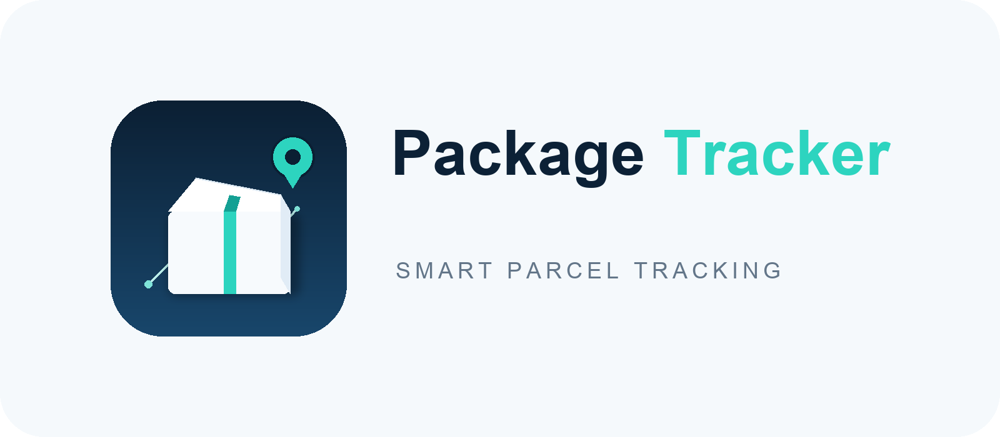

# Package Tracker

[**English**](README.md) · [Deutsch](README.de.md)



Intelligent parcel tracking for Home Assistant – fully local, no external AI, no marketing database.

Package Tracker connects to your Gmail inbox through the official Gmail API (read-only), recognises order and shipping e-mails, merges related messages into **one parcel**, and exposes everything through a native Home Assistant integration, sensors, events, automations and a custom Lovelace card.

> **Status:** 1.0.3 – production-ready, tested with Home Assistant 2026.10.4, Python 3.14 and TypeScript/Lit 3.
>
> **Important:** Parcel recognition is a local heuristic. It is intentionally conservative and is continuously extended with real-world merchant and carrier templates. No tracking information is invented. If no official interface exists, the field stays empty.

---

## Table of contents

1. [Features](#features)
2. [Architecture and data model](#architecture-and-data-model)
3. [Requirements](#requirements)
4. [Installation via HACS](#installation-via-hacs)
5. [Manual installation](#manual-installation)
6. [Set up Google Cloud and the Gmail API](#set-up-google-cloud-and-the-gmail-api)
7. [Set up the integration](#set-up-the-integration)
8. [Options](#options)
9. [Dashboard card](#dashboard-card)
10. [Sensors and entities](#sensors-and-entities)
11. [Events](#events)
12. [Services / actions](#services--actions)
13. [Notifications](#notifications)
14. [Automations and smart-home integration](#automations-and-smart-home-integration)
15. [Optional external tracking](#optional-external-tracking)
16. [Privacy and security](#privacy-and-security)
17. [Troubleshooting](#troubleshooting)
18. [Limitations and design decisions](#limitations-and-design-decisions)
19. [Development and tests](#development-and-tests)
20. [Releases and HACS](#releases-and-hacs)

---

## Features

- **Gmail API, read-only** (`gmail.readonly`), OAuth2 through the Home Assistant config flow.
- **Local e-mail analysis** in Python: sender, subject, plain text, HTML, links, product images, order numbers, tracking numbers, delivery dates and time windows.
- **Central parcel management** with orders and shipments. One order can contain several shipments; several e-mails are merged into one parcel.
- **Supported carriers:** DHL, Deutsche Post, Hermes, DPD, GLS, UPS, FedEx and Amazon Logistics.
- **10 status values:** `ordered`, `shipped`, `in_transit`, `out_for_delivery`, `delivered`, `delayed`, `ready_for_pickup`, `returned`, `cancelled`, `unknown`.
- **Persistent storage** through Home Assistant `Store`, surviving restarts and updates.
- **Events** for every status change and a dedicated event system for automations.
- **Optional push notifications** through the normal Home Assistant `notify` architecture – provider-independent and duplicate-free.
- **Native device triggers, conditions and actions** for the automation editor.
- **Custom Lovelace card** `custom:package-tracker-card` with overview, filters, search, sorting, detail view and a visual configuration editor.
- **Optional external tracking** (DHL Unified API or a custom JSON endpoint) – disabled by default, errors isolated.
- **Privacy:** no e-mail bodies are persisted, no data is sent to AI services, tokens are redacted in diagnostics.
- **English by default, German translation included.** E-mail recognition itself understands German and English shipping terminology.

### Intentionally not included

- No invented tracking events, no demo parcels in the production UI.
- No scraping of carrier websites as a requirement.
- No mandatory paid tracking API.
- No external AI API.
- No guarantee of minute-accurate delivery windows – they come from merchant/carrier e-mails.

---

## Architecture and data model

```text
Gmail API (readonly)
        │
        ▼
GmailClient ──► EmailParser (local, rule based)
        │                 │
        │                 ▼
        │           ParsedEmail
        │                 │
        ▼                 ▼
PackageTrackerCoordinator ◄── PackageManager (single source of truth)
        │                         │
        │                         ├── Order
        │                         └── Shipment (the parcel shown in the UI)
        │
        ├── Home Assistant events
        ├── Notify services
        ├── Sensors / binary sensors / buttons
        ├── Services & device automations
        ├── WebSocket API
        └── Lovelace card
```

### Order vs. shipment

- **Order:** merchant, order number, order date, product list, related shipments and e-mail references.
- **Shipment:** the physical parcel with its own stable ID, carrier, tracking number, product, dates and complete status history.

One order can contain several shipments (for example, Amazon splitting an order into two parcels). Multiple e-mails for the same shipment are merged.

### Stable IDs

- Shipment ID: derived from the normalised tracking number when available, otherwise deterministically from the order/thread/e-mail.
- Order ID: derived from merchant + order number, otherwise from thread/e-mail.
- IDs survive restarts and are stored in the Store file.

### Merge rules (excerpt)

1. Same normalised tracking number → same shipment.
2. Same order number + merchant → matching shipment; an existing placeholder is enriched.
3. New tracking number for an existing order → new shipment (multi-parcel order).
4. No tracking number: product similarity, order number, merchant and time window; merging only on a unique match.
5. A return label is **not** a returned parcel. A return label does not change the status.
6. Status is never downgraded automatically; `delivered`, `returned` and `cancelled` are terminal.
7. Processed Gmail message IDs are persisted. Overlapping sync windows do not create duplicates.
8. Invoices, review requests, newsletters and coupon mails are rejected even if they contain an order number.
9. Order confirmations only become active parcels within the configurable **order placeholder** window (default: 7 days). Older orders are retained for later matching but only appear when a shipping/tracking e-mail arrives.

---

## Requirements

- Home Assistant **2026.10 or newer** (tested with 2026.10.4).
- A Google account with Gmail.
- A Google Cloud project with the **Gmail API** enabled.
- A publicly reachable **HTTPS URL** for the OAuth redirect:
  - recommended: **My Home Assistant** (`https://my.home-assistant.io/redirect/oauth`), or
  - a configured external HTTPS URL, e.g. `https://home.example.com/auth/external/callback`.
- Internet access from Home Assistant to `gmail.googleapis.com`, `oauth2.googleapis.com` and `accounts.google.com`.

---

## Installation via HACS

1. Open HACS → **Integrations** → three-dot menu → **Custom repositories**.
2. Add this repository URL, category **Integration**.
3. Install **Package Tracker**.
4. Restart Home Assistant.
5. Go to **Settings → Devices & services → Add integration → Package Tracker**.
6. Connect Gmail (see below).

The Lovelace card is included in the integration package. It is automatically registered as a frontend resource (`/package_tracker_static/package-tracker-card.js`). No editing of Home Assistant Core files is required.

If the card does not appear after an update, clear the browser cache or reload the resource. As a fallback, add it manually under **Settings → Dashboards → Resources** as a JavaScript module:

```text
/package_tracker_static/package-tracker-card.js
```

---

## Manual installation

1. Copy `custom_components/package_tracker` into
   `<HA config directory>/custom_components/package_tracker`.
2. Make sure `manifest.json`, all Python files and
   `frontend/package-tracker-card.js` are present.
3. Restart Home Assistant.
4. Add the integration through the UI.

---

## Set up Google Cloud and the Gmail API

These steps are performed once in the [Google Cloud Console](https://console.cloud.google.com/).

### 1. Create a project

Create a new project, e.g. `Home Assistant Package Tracker`.

### 2. Enable the Gmail API

**APIs & Services → Library → Gmail API → Enable**.

### 3. OAuth consent screen

**APIs & Services → OAuth consent screen**:

- User type: **External** (for personal Google accounts).
- Fill in app name, support e-mail and developer contact.
- **Scopes:** add `https://www.googleapis.com/auth/gmail.readonly`.
- In testing mode, add your Google account as a **test user**.
- For permanent operation, publish the app. Google may require verification for sensitive scopes; this is a Google process, not part of this integration.

### 4. Create OAuth client

**APIs & Services → Credentials → Create credentials → OAuth client ID**:

- Application type: **Web application**.
- Name: e.g. `Home Assistant`.
- **Authorised redirect URI:**

```text
https://my.home-assistant.io/redirect/oauth
```

or, without My Home Assistant:

```text
https://<your-external-home-assistant-url>/auth/external/callback
```

The URI must match **exactly** the URI shown in the config flow (including `https://`, no trailing slash).

### 5. Note the client ID and client secret

Both are entered in Home Assistant. The client secret is not your Gmail password; it only identifies the OAuth application.

> **Security:** the client secret is stored in the Home Assistant config entry (as with other OAuth integrations). Tokens are managed by Home Assistant and refreshed automatically. Secrets are redacted in diagnostics.

---

## Set up the integration

1. **Settings → Devices & services → Add integration → Package Tracker**.
2. Enter the client ID and client secret.
3. Click **Next** and complete the Google login in the popup.
4. Grant **read-only Gmail access**. Without this scope the setup stops with a clear message.
5. Choose the sync interval and initial import period.
6. Optionally configure a `notify` service and notification events immediately.
7. Finish. The initial import starts immediately.

### Synchronisation

- Default interval: **5 minutes** (configurable 1–1440).
- Initial import: **30 days** by default (configurable 1–365).
- Gmail search query is configurable; the default is deliberately broad and refined locally.
- Read and archived e-mails are included. `is:unread` is not used.
- Manual sync: `button.package_tracker_sync` or service `package_tracker.sync`.
- Per-sync limit: 1000 messages by default. If exceeded, a warning is logged; adjust the limit or the search query.
- Tokens refresh automatically through Home Assistant. If access is revoked, the integration starts a reauth flow and creates a repair issue.

---

## Options

**Settings → Devices & services → Package Tracker → Configure**

| Option | Default | Meaning |
|---|---:|---|
| Sync interval | 5 min | Gmail polling; 1–1440 minutes |
| Initial import | 30 days | Initial import window |
| Gmail search query | broad default | server-side Gmail filter; local analysis is authoritative |
| Max messages per sync | 1000 | protects against overload |
| Store e-mail subjects | on | subject metadata only; bodies are never stored |
| Keep delivered parcels | 90 days | automatic cleanup; `0` = forever |
| Order placeholders | 7 days | order confirmations within this window are shown as active parcels; older orders are stored but only appear when a shipping/tracking e-mail arrives; `0` = unlimited |
| Notification service | empty | e.g. `mobile_app_phone` or `notify.mobile_app_phone` |
| Notification events | delivery, delay, pickup, … | multi-select |
| Tracking provider | disabled | `dhl_unified` or `custom_json` |
| Tracking interval | 60 min | `0` = off |
| Tracking API key | empty | for DHL Unified API |
| Tracking URL / headers / JSON paths | empty/defaults | for custom JSON endpoint |

Changes are applied without a restart. A new sync interval takes effect immediately.

---

## Dashboard card

### Add the card

Edit the dashboard → **Add card** → manual:

```yaml
type: custom:package-tracker-card
```

Or use the visual editor. The card is loaded automatically as a resource.

### Full YAML configuration

```yaml
type: custom:package-tracker-card
title: Parcels
max_packages: 12
show_delivered: false
show_images: true
show_delivery_dates: true
compact: false
default_filter: all
sort_by: expected
show_stats: true
show_search: true
show_last_sync: true
```

| Option | Type | Default | Description |
|---|---|---|---|
| `title` | string | localised “Parcels” | heading |
| `max_packages` | number | 24 | maximum number of parcels shown |
| `show_delivered` | boolean | false | show delivered parcels by default |
| `show_images` | boolean | true | show product images from e-mails when available |
| `show_delivery_dates` | boolean | true | show delivery date/time window on cards |
| `compact` | boolean | false | compact list layout |
| `default_filter` | string | `all` | `all`, `transit`, `today`, `delivered`, `delayed`, `pickup` |
| `sort_by` | string | `expected` | `expected`, `carrier`, `merchant`, `status` |
| `show_stats` | boolean | true | show the statistics bar |
| `show_search` | boolean | true | show the search field |
| `show_last_sync` | boolean | true | show the last Gmail sync in the header |

### Interaction

- **Statistics tiles:** in transit, today, delivered, next delivery. Click to filter or open the next parcel.
- **Filter chips:** all, in transit, today, delivered, delayed, ready for pickup.
- **Search:** merchant, product, tracking number, order number, carrier.
- **Sorting:** delivery date, carrier, merchant, status.
- **Click a parcel:** detail view with order data, product, tracking number, tracking link, complete status history, e-mail metadata, other shipments in the order and optional tracking.
- **Keyboard:** cards are reachable via Tab/Enter/Space; Escape closes the detail sheet.
- **Responsive:** phone (single column, bottom sheet), tablet and desktop (grid).
- **Light/dark:** Home Assistant CSS variables only, no hard-coded surfaces.
- **No sample data:** empty, loading and error states are explicit.

### Data source

The card first loads through the WebSocket API `package_tracker/packages` (complete shared data set including history). If unavailable, it falls back to the attributes of `sensor.package_tracker_packages` and the per-parcel sensors. Updates arrive through `package_tracker_updated`.

### Example configurations

```yaml
# Compact, active parcels only
type: custom:package-tracker-card
title: In transit
compact: true
default_filter: transit
max_packages: 6
show_stats: false

# Daily overview including delivered parcels
type: custom:package-tracker-card
default_filter: today
show_delivered: true
show_images: true
```

More examples: [docs/dashboard.yaml](docs/dashboard.yaml).

---

## Sensors and entities

All aggregate entities belong to the device **Package Tracker**.

| Entity | State | Important attributes |
|---|---|---|
| `sensor.package_tracker_packages` | number of active parcels | `packages`, `counts`, `gmail`, `sync`, `updated_at` |
| `sensor.package_tracker_deliveries_today` | deliveries today | `packages`, `count` |
| `sensor.package_tracker_next_delivery` | next delivery date (`date`) | `package`, `product_name`, `merchant`, `carrier`, `delivery_window`, `tracking_url` |
| `sensor.package_tracker_delivered_today` | delivered today | `packages`, `count` |
| `sensor.package_tracker_packages_in_transit` | parcels in transit | `packages`, `count` |
| `sensor.package_tracker_delayed` | delayed parcels | `packages`, `count` |
| `sensor.package_tracker_last_sync` | last sync timestamp | `emails_processed`, `connected`, `account` (disabled by default) |

Additional entities:

| Entity | Meaning |
|---|---|
| `binary_sensor.package_tracker_delivery_today` | delivery expected today |
| `binary_sensor.package_tracker_package_out_for_delivery` | at least one parcel out for delivery |
| `binary_sensor.package_tracker_delayed` | at least one delayed parcel |
| `binary_sensor.package_tracker_gmail_connected` | Gmail account connected (diagnostic) |
| `button.package_tracker_sync` | manual Gmail sync |
| `button.package_tracker_refresh_tracking` | refresh optional tracking |
| `sensor.package_tracker_package_<merchant>_<id>` | one sensor per recognised parcel |

The per-parcel sensor uses the status as its state and exposes:
`package_id`, `merchant`, `carrier`, `carrier_name`, `product_name`, `product_names`, `product_image`, `order_number`, `tracking_number`, `tracking_url`, `order_date`, `shipped_date`, `expected_delivery`, `delivery_window`, `actual_delivery`, `status_label`, `status_history`, `emails`, `order`, `siblings`, `tracking`, `completed`, `notes`.

Template examples:

```jinja
{{ states('sensor.package_tracker_packages') }} active parcels
{{ state_attr('sensor.package_tracker_next_delivery', 'product_name') }}
{{ state_attr('sensor.package_tracker_next_delivery', 'delivery_window') }}
```

---

## Events

Every event contains relevant parcel data, including `package_id`, `merchant`, `carrier`, `carrier_name`, `product_name`, `product_names`, `order_number`, `tracking_number`, `tracking_url`, `status`, `previous_status`, `expected_delivery`, `delivery_window`, `actual_delivery`, `email_ids`, `entity_id`, `source` and `timestamp`.

| Event | Trigger |
|---|---|
| `package_tracker_package_found` | new parcel created |
| `package_tracker_package_ordered` | status `ordered` |
| `package_tracker_package_shipped` | status `shipped` |
| `package_tracker_package_in_transit` | status `in_transit` |
| `package_tracker_package_out_for_delivery` | status `out_for_delivery` |
| `package_tracker_package_delivered` | status `delivered` |
| `package_tracker_package_delayed` | status `delayed` |
| `package_tracker_package_ready_for_pickup` | status `ready_for_pickup` |
| `package_tracker_package_returned` | status `returned` |
| `package_tracker_package_cancelled` | status `cancelled` |
| `package_tracker_updated` | data changed (for dashboards) |

Events fire only on real status changes or when a parcel is created. Repeated identical e-mails or status messages do not create duplicates.

---

## Services / actions

All services are available in the automation editor under **Package Tracker**. `config_entry_id` is optional and only needed with multiple Gmail accounts.

### `package_tracker.sync`

```yaml
action: package_tracker.sync
```

### `package_tracker.refresh`

Rebuilds the overview from stored data and notifies the dashboard via `package_tracker_updated`, without fetching Gmail.

```yaml
action: package_tracker.refresh
```

### `package_tracker.refresh_tracking`

```yaml
action: package_tracker.refresh_tracking
data:
  package_id: "pkg_..."
```

### `package_tracker.mark_delivered`

```yaml
action: package_tracker.mark_delivered
data:
  package_id: "pkg_..."
  delivered_at: "2026-11-27"
```

### `package_tracker.mark_completed`

```yaml
action: package_tracker.mark_completed
data:
  package_id: "pkg_..."
  completed: true
```

### `package_tracker.update_package`

```yaml
action: package_tracker.update_package
data:
  package_id: "pkg_..."
  merchant: "Amazon"
  carrier: "DHL"
  tracking_number: "00340434161094000000"
  expected_delivery: "2026-11-27"
  delivery_window: "14:00–18:00 Uhr"
  status: delayed
```

### `package_tracker.delete_package`

```yaml
action: package_tracker.delete_package
data:
  package_id: "pkg_..."
```

### `package_tracker.delete_all_data`

```yaml
action: package_tracker.delete_all_data
data:
  confirm: true
  reset_sync: false
```

`reset_sync: true` also resets the Gmail watermark; older e-mails are imported again on the next sync.

### `package_tracker.disconnect_account`

Removes the config entry, revokes the Google token (best effort) and deletes the local Store file.

```yaml
action: package_tracker.disconnect_account
```

### `package_tracker.get_packages`

Returns a response for scripts/templates:

```yaml
action: package_tracker.get_packages
data:
  status: in_transit
response_variable: parcels
```

---

## Notifications

The integration uses the normal Home Assistant `notify` architecture. There is no binding to a specific push provider.

### Setup

1. Configure a working notify service (e.g. the Home Assistant Companion app).
2. In the integration options, enter the service name without `notify.`, e.g. `mobile_app_phone`.
3. Select the events to notify, e.g. “Parcel out for delivery”, “Parcel delivered”, “Parcel delayed”, “Parcel ready for pickup”.

### Duplicate prevention

- A notification is only triggered on a real status change.
- Already processed Gmail IDs are persisted.
- A send timestamp is stored per parcel + status; identical messages within 12 hours are suppressed.
- If the configured notify service is missing, a warning is logged and nothing is sent.
- When one sync catches up on several status changes for the same parcel, only the latest eligible change is notified.

### Example message

> **Parcel out for delivery**  
> Your parcel is on its way!
>
> “Logitech MX Master 4” from Amazon is expected today.
>
> Delivery window: 14:00–18:00 Uhr  
> Carrier: DHL  
> Tracking number: 00340434161094000000

For Companion apps, `tag`, `group`, `url` and `clickAction` are set with the tracking link. Messages are English by default and German when Home Assistant is set to German.

### Alternative: your own automations

If you want full control over text and recipients, leave the notify service empty and react to events. Examples: [docs/automations.md](docs/automations.md).

---

## Automations and smart-home integration

The integration provides native **device triggers**, **device conditions** and **device actions** on the device “Package Tracker”.

### Triggers

- parcel detected
- parcel ordered
- parcel shipped
- parcel in transit
- parcel out for delivery
- parcel delivered
- parcel delayed
- parcel ready for pickup
- parcel returned
- order cancelled
- parcel status changed (optional `package_id` filter)

### Conditions

- parcel has status …
- carrier is …
- merchant is …
- product contains …
- a delivery is expected today
- a parcel exists

### Actions

- sync Gmail now
- refresh tracking
- mark parcel as delivered
- mark parcel as completed
- delete parcel

### Example: push on delivery

```yaml
alias: Parcel delivered – push
trigger:
  - platform: event
    event_type: package_tracker_package_delivered
action:
  - action: notify.mobile_app_phone
    data:
      title: Parcel delivered
      message: >-
        {{ trigger.event.data.product_name }} from
        {{ trigger.event.data.merchant }} was delivered.
```

### Example: light on out for delivery

```yaml
alias: Parcel out for delivery – hallway light
trigger:
  - platform: event
    event_type: package_tracker_package_out_for_delivery
action:
  - action: light.turn_on
    target:
      entity_id: light.hallway
    data:
      brightness_pct: 35
      color_name: green
```

### Example: dashboard notification today

```yaml
alias: Delivery today
trigger:
  - platform: time
    at: "07:30:00"
condition:
  - condition: state
    entity_id: binary_sensor.package_tracker_delivery_today
    state: "on"
action:
  - action: persistent_notification.create
    data:
      title: Delivery today
      message: >-
        {{ state_attr('sensor.package_tracker_next_delivery', 'product_name') }}
        is expected today.
```

More examples: [docs/automations.md](docs/automations.md).

---

## Optional external tracking

Gmail data is the primary source. External tracking is **disabled by default** and never a requirement.

### DHL Unified API (official)

- Request a free API key at [DHL Developer](https://developer.dhl.com/).
- Options: provider `dhl_unified`, API key, interval.
- Endpoint: `https://api-eu.dhl.com/track/shipments`
- Tracking data is stored separately under `tracking` on the parcel. E-mail facts (merchant, product, order, e-mail history) are not overwritten. An external delivery estimate does not replace a known e-mail date; it remains visible as `tracking.expected_delivery`.
- Errors (401, 404, 429, 5xx, timeout) are stored as `tracking.error` and do not affect Gmail sync.

### Custom JSON endpoint

Options: `custom_json`, URL template containing `{tracking}`, optional header/token and JSON paths. Expected response example:

```json
{
  "status": "in_transit",
  "expected_delivery": "2026-12-01",
  "events": [
    {
      "timestamp": "2026-11-26T09:00:00+00:00",
      "description": "Arrived at the parcel centre"
    }
  ]
}
```

- Status values are mapped using German/English keywords.
- Paths use dot notation (`data.history`, `events.0.time`).
- Only GET requests are made; no JavaScript, no scraping.
- Contract and security notes: [docs/tracking-provider.md](docs/tracking-provider.md).

---

## Privacy and security

- **Read-only access:** `https://www.googleapis.com/auth/gmail.readonly`.
- **No Gmail password:** login is OAuth2 only; Home Assistant stores access/refresh tokens in the config entry and refreshes them automatically.
- **Local analysis:** the parser runs entirely inside Home Assistant. No e-mail content is sent to external services, AI APIs or advertising networks.
- **No body storage:** e-mail text and HTML are processed in memory and discarded. Extracted parcel data and e-mail metadata (ID, timestamp, optional subject/sender domain, detected type) are stored.
- **Subjects can be disabled:** turn off “Store e-mail subjects”; existing subjects are removed.
- **Diagnostics:** tokens, client secret, API keys, e-mail addresses and tracking numbers are redacted; e-mail bodies are never included.
- **Deletion:** `package_tracker.delete_all_data` removes parcels/orders; `package_tracker.disconnect_account` removes the entry, revokes the token and deletes the Store file.
- **Retention:** default 90 days for terminal parcels; `0` = forever.
- **External product images:** images are extracted from e-mails and loaded directly from the merchant CDN. This exposes your browser IP to that CDN. Disable images in the card options if undesired.
- **Tracking headers:** custom headers/keys are stored in the config entry and redacted in diagnostics.

---

## Troubleshooting

### “No public HTTPS URL is available” / `no_url_available`

- Set up My Home Assistant **or** configure an external HTTPS URL in Home Assistant.
- The redirect URI in Google Cloud must match the URI shown in the form exactly.

### Google reports `redirect_uri_mismatch`

- Correct the URI in Google Cloud:
  - My Home Assistant: `https://my.home-assistant.io/redirect/oauth`
  - Own URL: `https://<host>/auth/external/callback`
- No trailing slash, exact HTTPS.

### `invalid_client` / `invalid_client_id`

- The client ID must end with `.apps.googleusercontent.com`.
- Copy the client secret completely (no spaces).

### `missing_scope` / access denied

- Grant Gmail read access on the Google consent screen.
- If the app is in testing mode, add the account as a test user.
- After scope changes, remove the app’s access in your Google account and reconnect.

### `no_refresh_token`

- Google did not issue a new refresh token because consent was already granted.
- Remove the app’s access in your Google account and repeat setup, or use the repair issue to reauthenticate.

### Repair issue “Gmail authorization failed”

- Click **Fix** and sign in again. The reauth flow updates the token without losing parcel data.

### No parcels are detected

- Check whether the e-mails are within the selected period (`initial_sync_days`).
- Is the Gmail search query too narrow? Use the default or add merchants/carriers.
- Trigger a manual sync (`button.package_tracker_sync`).
- Enable debug logging for `custom_components.package_tracker`; only message IDs, error types and counts are logged, no content.
- Recognition is heuristic. New merchant templates can be added (see development).

### Too many messages / incomplete sync

- Increase `max_messages_per_sync` (max 2000) or reduce the import period.
- Watch for the log warning “Gmail returned more messages than the configured limit”.

### Gmail rate limit (HTTP 429)

- Increase the sync interval.
- The Gmail API has per-minute/daily quotas; the integration retries on the next interval.

### Card does not appear

- Reload the integration or restart Home Assistant.
- Clear the browser cache.
- Check that `/package_tracker_static/package-tracker-card.js` is reachable.
- Alternatively add the resource manually as a JavaScript module.
- After a HACS update, reload the frontend resource.

### Product images are missing

- Not every e-mail contains a product image.
- Images may be blocked by the merchant’s privacy/tracking filters.
- `http://` images are blocked by HTTPS dashboards; the card then shows a merchant monogram fallback.
- `show_images: false` disables images completely.

### Old orders or products from invoice/review mails appear

- Invoice, review, newsletter and coupon mails are rejected by subject and sender address, even if they contain an order number.
- Order confirmations are only shown as active parcels within the configured **order placeholder** period (default: 7 days). Older orders are retained for later shipping matching.
- Existing bad imports must be cleared once:

```yaml
action: package_tracker.delete_all_data
data:
  confirm: true
  reset_sync: true
```

Then call `package_tracker.sync`. With `reset_sync: true`, the Gmail period is imported again using the stricter filters. Alternatively set the order placeholder to e.g. `3` days or start the card with `default_filter: transit`.

### “Duplicate” parcels

- A shared tracking or order number is usually missing. The integration only merges on unambiguous signals.
- Correct the tracking/order number with `update_package`, or delete one of the parcels.
- Report recurring cases with an anonymised example.

### Time zone / “today” is wrong

- The integration uses the Home Assistant time zone. Delivery dates from e-mails are date values; time windows are displayed as text.
- Check **Settings → System → General → Time zone**.

### Multiple Gmail accounts

- Multiple config entries are supported; services accept `config_entry_id`.
- Entity IDs of the second account may get a suffix. The card merges all accounts by default; one account can be filtered via WebSocket/service.
- One account is recommended for most users.

---

## Limitations and design decisions

1. **E-mail heuristics, not a guarantee:** merchants change templates. The integration combines sender, subject, text, HTML, links, product and tracking patterns to minimise misclassification. 100% coverage is impossible without official merchant APIs.
2. **No invented data:** if no tracking number, date or product image is recognised, the field stays empty. The card shows “Date pending” or a merchant fallback.
3. **Tracking links are convenience:** they lead to official carrier pages. Amazon Logistics links may require an Amazon login.
4. **No universal free tracking API:** external tracking is optional. The DHL Unified API is official but not mandatory; custom endpoints are documented.
5. **Time windows are text:** extracted windows are shown but not treated as guaranteed delivery times.
6. **Google verification:** the `gmail.readonly` scope is sensitive. For permanent use outside test users, Google may require verification.
7. **Product images are external:** they are not proxied through Home Assistant.
8. **One source of truth:** the card, sensors, events, services and automations all use the same `PackageManager` data structure.

---

## Development and tests

### Requirements

- Python **3.14**
- Node.js **22+** (for the card)
- Home Assistant test harness

### Backend

```bash
python3.14 -m venv .venv
source .venv/bin/activate
pip install -r requirements_test.txt
pytest -q
ruff check custom_components tests
```

Tests cover:

- Gmail MIME decoding, pagination, error mapping and OAuth probing
- Parser for Amazon, DHL, DPD, Hermes, GLS, UPS, FedEx, Deutsche Post, Amazon Logistics, returns, delays, marketing exclusion and malformed HTML
- Merging: order → shipping → tracking → delivery, multi-parcel orders, missing tracking numbers, duplicates, status downgrade protection, return labels, invoice/review rejection, old order placeholders
- Persistence and restart
- Sensors, entity IDs, attributes, events, services, notifications (including duplicate prevention and German translation)
- WebSocket API, diagnostics redaction, device triggers/conditions/actions
- Config flow, reauth, options flow
- Tracking providers (DHL/custom) and error isolation

### Frontend

```bash
cd frontend
npm ci
npx tsc --noEmit
npx vitest run
npm run build
```

The build writes to `custom_components/package_tracker/frontend/package-tracker-card.js`. This bundle is committed so HACS does not need a build toolchain.

### Project structure

```text
custom_components/package_tracker/
├── __init__.py           # setup, OAuth session, frontend resource
├── manifest.json
├── config_flow.py        # OAuth, reauth, options
├── const.py
├── coordinator.py        # DataUpdateCoordinator, sync, events
├── gmail_client.py       # official Gmail REST API, MIME
├── email_parser.py       # local heuristics
├── package_manager.py    # central merge & persistence model
├── models.py             # Shipment, Order, StatusEvent …
├── storage.py            # Store wrapper
├── tracking.py           # optional providers
├── notifications.py      # events + notify
├── sensor.py / binary_sensor.py / button.py
├── services.py
├── websocket.py
├── diagnostics.py
├── repairs.py
├── device_trigger.py / device_condition.py / device_action.py
├── brand/                # icon.png, logo.png, dark variants, @2x
├── strings.json / translations/de.json
├── services.yaml
└── frontend/package-tracker-card.js

frontend/src/             # TypeScript/Lit sources + Vitest
tests/                    # pytest + anonymised fixtures
docs/                     # automation, tracking and dashboard docs
```

### Adding merchants/carriers

- Merchant domain/name: `MERCHANT_DOMAINS` in `email_parser.py`.
- Carrier: `CARRIER_*` in `const.py`, `TRACKING_URL_TEMPLATES`, `CARRIER_DOMAINS` and tracking patterns in `email_parser.py`.
- New status/product patterns: `_DELIVERED_PHRASES`, `_SHIPPED_PHRASES`, etc.; add a fixture and test.
- No changes to Home Assistant Core files.

---

## Releases and HACS

1. Keep the version consistent in `custom_components/package_tracker/manifest.json`, `const.py` (`VERSION`), `frontend/package.json` and the changelog.
2. Build the frontend (`npm run build`) and commit the bundle.
3. Run tests.
4. Push to `main` and create a tag `vX.Y.Z`. The GitHub Action creates `package_tracker.zip` and a release.
5. HACS installs directly from the repository (`zip_release: false`); the ZIP release is additionally available for manual installation.

---

## License

MIT – see [LICENSE](LICENSE).

Package Tracker is an independent community project and is not affiliated with Amazon, DHL, Deutsche Post, Hermes, DPD, GLS, UPS, FedEx or Google.
